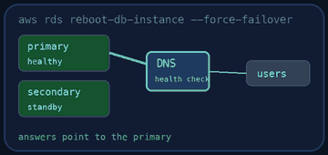
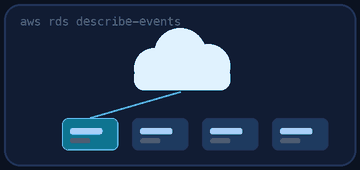
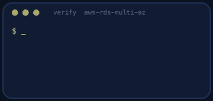
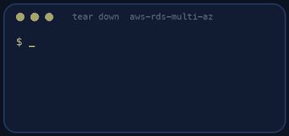

<p align="center"></p>

| | |
|-|-|
| **Time** | 75-90 min (plus waiting for AWS) |
| **Cost** | a few cents (a small Multi-AZ database for about an hour; deleted at the end) |
| **You need** | An AWS administrator user (the IAM lab), the AWS CLI v2 configured for it, Python 3 and a terminal |

## How this lab works

1. **Fork** this repository to your own GitHub account (button at the top right).
2. Clone **your fork** in your Ubuntu environment (WSL on Windows, your OrbStack machine on Mac).
3. Read the lab below (the same text is in [`LAB.md`](LAB.md)) and follow the mission.
4. Answer the questions in [`SUBMISSION.md`](SUBMISSION.md). Where a question asks for output, paste it in a code block. No screenshots needed.
5. Commit and push. Open the **Actions** tab of your fork (click *I understand my workflows, go ahead and enable them* the first time). The **Lab check** shows what is still missing.
6. When the check is green, **submit the URL of your fork** in the course platform.

> [!NOTE]
> The check only looks at your answers and any files the lab asks you to commit. Your instructor reads your work and may ask you to explain any line.

<p align="center"></p>

## 🎬 The situation

<p align="center"></p>

Every short link Clippy ever created lives in one PostgreSQL database on one machine in one building. If that machine dies, if the building loses power, if AWS has to patch the host, Clippy is down and nobody can say for how long. Worse, if the disk is lost, so is every link.

You will build the database the way production needs it: **private** (no address on the internet), **encrypted**, **backed up** and **Multi-AZ**, which means AWS keeps a second copy in a second data center and promotes it by itself when the first one fails. Then you will cause the failure yourself and measure what changes, and what does not.

> [!IMPORTANT]
> **Your mission**
> - Create the network pieces: a DB subnet group over two zones, and a security group that lets **only the app tier** reach port 5432
> - Create a small Multi-AZ PostgreSQL database that is private, encrypted, backed up for a week, with a master password that **you never see** (AWS keeps it in Secrets Manager)
> - Force a failover and watch the zone change while the address stays the same
> - Tear it down (a running database bills every hour) and prove it

**Time:** 75-90 min (plus waiting for AWS: about 15 minutes to create and 10 to delete) | **Cost:** a few cents (a small Multi-AZ database for about an hour; deleted at the end) | **You need:** an AWS administrator user, the AWS CLI v2 configured for it, Python 3 and a terminal. The lab uses your default VPC.

<p align="center"></p>

## Part 0 - Set the scene

1. **Fork** this repository, clone it, and create the "app tier" security group that will stand for the servers that call the database:

```bash
./setup.sh
```

2. In the **RDS console** click *Create database* and walk through every section without finishing it: engine, templates (Production / Dev-Test / Free tier), availability, storage, connectivity, encryption, backup, maintenance. Decide what you would choose and why. Then cancel. You will build it with the CLI next, which makes every choice explicit.

> [!NOTE]
> **Think** The template "Free tier" and the template "Production" change many defaults at once (Multi-AZ, public access, backup retention, deletion protection). Why is it dangerous to start from a template without reading what it changed?

<p align="center"></p>

## Part 1 - The network around the database

<p align="center"></p>

1. **DB subnet group** `clippy-db`: the subnets of your default VPC (it must cover **at least two availability zones**, or RDS refuses).

```bash
VPC=$(aws ec2 describe-vpcs --filters Name=isDefault,Values=true --query 'Vpcs[0].VpcId' --output text)
aws ec2 describe-subnets --filters Name=vpc-id,Values=$VPC --query 'Subnets[].[SubnetId,AvailabilityZone]' --output text
aws rds create-db-subnet-group --db-subnet-group-name clippy-db --db-subnet-group-description "Clippy database" --subnet-ids <ids> --tags Key=lab,Value=aws-rds-multi-az
```

2. **Security group** `clippy-db` in the same VPC, tagged `lab = aws-rds-multi-az`, with **one** inbound rule: TCP 5432 whose source is the **security group `clippy-app`** (not a CIDR, and not `0.0.0.0/0`).

> [!NOTE]
> **Think** In production the app servers change all the time (new instances, new IPs). What does referencing a security group instead of an address buy you?

<p align="center"></p>

## Part 2 - The database

Create the instance `clippy-db` with the CLI. Every option below is a decision:

| Decision | Value |
|----------|-------|
| engine | `postgres` |
| class | `db.t3.micro` (small and cheap; production would be bigger) |
| storage | 20 GiB `gp3`, **encrypted** |
| availability | **Multi-AZ** |
| exposure | **not publicly accessible** |
| subnets / firewall | the subnet group and security group above |
| backups | **7 days** retention |
| master user | `clippy`, with `--manage-master-user-password` (AWS generates it and keeps it in Secrets Manager: it never appears in your shell history, your repository or this lab) |
| tag | `lab = aws-rds-multi-az` |

Find the command with `aws rds create-db-instance help`. Do not put a password in any file.

```bash
aws rds wait db-instance-available --db-instance-identifier clippy-db     # about 15 minutes
```

While you wait, read about what Multi-AZ actually does: it is **synchronous replication** to a standby you cannot connect to, not a read replica.

> [!NOTE]
> **Think** `--manage-master-user-password` created a secret you did not name. Where is it (`aws secretsmanager list-secrets`), and what happens to it when you delete the database? What does it save you compared with a password you invented?

<p align="center"></p>

## Part 3 - Look at what you built

```bash
aws rds describe-db-instances --db-instance-identifier clippy-db \
  --query 'DBInstances[0].[DBInstanceStatus,AvailabilityZone,SecondaryAvailabilityZone,MultiAZ,StorageEncrypted,PubliclyAccessible,BackupRetentionPeriod,Endpoint.Address]' --output text
python3 -c "import socket,sys; print(socket.gethostbyname(sys.argv[1]))" <the endpoint address>
```

Note the zone, the standby zone and the **IP address** behind the endpoint name. The IP is a private address of the VPC: nothing outside can reach it.

<p align="center"></p>

## Part 4 - Cause the failure

Write down the zone and the IP, then force a failover (this simulates losing the primary's data center):

```bash
aws rds reboot-db-instance --db-instance-identifier clippy-db --force-failover
```

Watch it, every ten seconds, until it is `available` again:

```bash
while true; do date +%T; aws rds describe-db-instances --db-instance-identifier clippy-db --query 'DBInstances[0].[DBInstanceStatus,AvailabilityZone]' --output text; sleep 10; done
```

Then read the events and look at the endpoint again:

```bash
aws rds describe-events --source-identifier clippy-db --source-type db-instance --duration 60 --query 'Events[].[Date,Message]' --output text
python3 -c "import socket,sys; print(socket.gethostbyname(sys.argv[1]))" <the endpoint address>
```

The **zone changed**. The **endpoint name did not**: AWS moved the name to the standby. Applications connected through the name only need to reconnect.

> [!NOTE]
> **Think** How long was the database unavailable? What does your application need to survive a failover (retries with a back-off, not caching the resolved IP forever)? Why would an app that connects with a hard-coded IP never recover?

<p align="center"></p>

## Part 5 - Prove it

<p align="center"></p>

```bash
./verify.sh
```

It reads the real database (Multi-AZ, encrypted, private, 7 days of backups, managed password, tags), its subnet group, the security group rule, and that RDS **recorded a completed failover** in its events. Fix what is red and run it again until it ends with **ALL CHECKS PASSED**.

> [!TIP]
> **Stuck?** `DBSubnetGroupDoesNotCoverEnoughAZs`: add a subnet from a second zone. `InvalidParameterCombination` about `--manage-master-user-password`: you also passed a password; use one or the other. The database stays in `creating` for a long time: that is normal, it builds two instances. Failover event missing: the `reboot` needs `--force-failover`.

<p align="center"></p>

## Level up (optional)

- Create a **read replica** in the other zone and compare what it does with what the Multi-AZ standby does. Which one can serve queries? Which one survives a failure of the primary without any action?
- Take a manual **snapshot**, delete the database, and restore it into a new instance. How long did that take compared with the failover?
- Turn on **Performance Insights** or **enhanced monitoring** and find the failover in the graphs.
- Connect from a server that uses the `clippy-app` security group and run `psql` with the password from Secrets Manager.

<!-- teardown:start (generated by labs.py, do not edit) -->
## Tear down (mandatory)

<p align="center"></p>

Resources left behind cost money, keep doors open and pollute the next lab. Removing what you created is part of the job, so it is part of the submission: **you must prove it is gone**.

Do this **last**, after you have pasted your `verify` output into `SUBMISSION.md` (once you tear down, the lab can no longer be verified).

1. Run `./teardown.sh`. It deletes the database (without a final snapshot), the subnet group and the security group. Deleting a Multi-AZ database takes several minutes. Then run `./verify-teardown.sh`.

Then run the proof:

```bash
./verify-teardown.sh
```

It prints a list of checks and must end with **TEARDOWN VERIFIED**. If it reports leftovers, remove them and run it again. Paste the full output in your submission.
<!-- teardown:end -->

<!-- submission:start (generated by labs.py, do not edit) -->
## 📬 Submission

Answer the questions in `SUBMISSION.md` in **your fork** (paste output in code blocks where asked), push, then submit the **URL of your fork**.

**Files to commit**

- `notes.md` with your commands and what you saw (optional)

**Questions to answer**

1. Paste `aws rds describe-db-instances` (the key fields) for your database. What do MultiAZ, StorageEncrypted, PubliclyAccessible and BackupRetentionPeriod say about its safety?
2. Paste the subnet group and the security group rule. Why is the database in private subnets and why is the source a security group?
3. Force a failover and paste the zone before and after, and the event messages. What stayed the same for the application and why does that matter?
4. How long was the database unavailable during the failover? What would your app need so that it survives it (connection retries, DNS caching)?
5. Multi-AZ and a read replica both create a copy. Which one is for availability and which one is for scaling reads, and can a Multi-AZ standby serve queries?
6. Paste the output of `./verify.sh`. It must end with **ALL CHECKS PASSED**.
7. **Tear down.** Paste the output of `./verify-teardown.sh`. It must end with **TEARDOWN VERIFIED**.
<!-- submission:end -->
